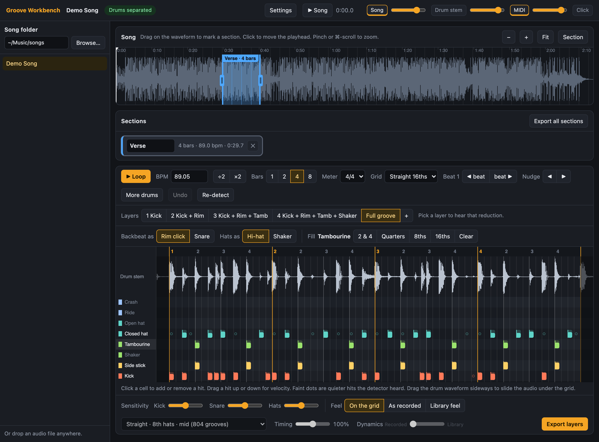
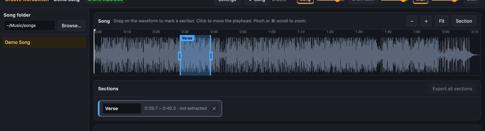
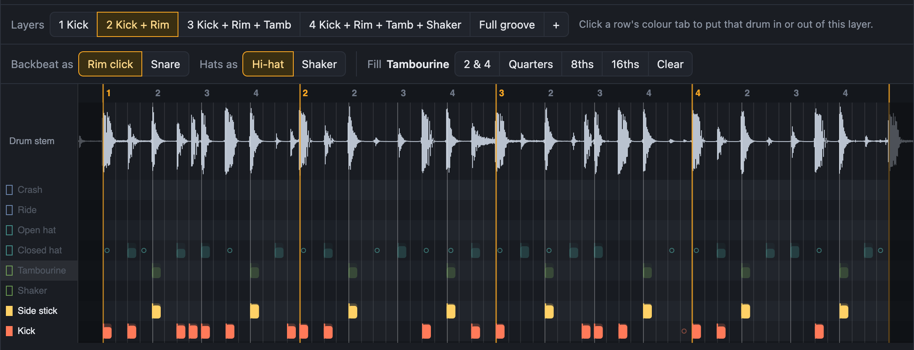
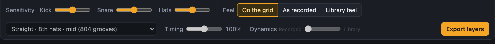
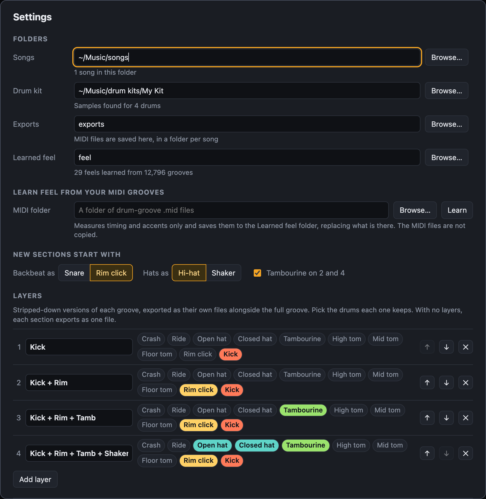

# Groove Workbench

Turn a section of a song into a short, loopable MIDI drum pattern for a drum pedal such as
the BeatBuddy.



Drop in a song, mark a section, and the app separates the drums, finds the tempo and bar
lines, and reads the kick, snare and hats into a drum-grid editor that sits on the same time
axis as the audio. Fix what is wrong, humanize it, and export `.mid` files, including
stripped-down layers (kick only, kick and rim, and so on) cut from the same groove.

It runs entirely on your own computer. You bring your own songs, and optionally your own drum
samples and MIDI groove library. None of that is included here.

## From audio to MIDI

### 1. Open a song and mark a section

Opening a song separates the drums from the rest of the mix. When the badge says "Drums
separated", drag across the part you want on the waveform, for example four bars of the verse.



### 2. Extract the drums

Extract finds the tempo and the downbeat, snaps the section to whole bars, and reads the kick,
snare and hats from the drum stem. The hits appear on a grid directly under the drum waveform,
so you can see whether each one lines up with what was played. Press Space to loop the section
and hear the MIDI against the song, the drum stem, or both.

If something is off, fix it there:

- Click a cell to add or remove a hit, and drag a hit up or down to change how hard it is played.
- Faint dots are quieter hits the detector heard but left out. The Sensitivity sliders bring
  them in or drop more.
- BPM, ÷2 and ×2, Bars, Meter, Grid and the Beat 1 buttons correct a wrong tempo or bar line.
- "Backbeat as" and "Hats as" choose which drum plays the snare and hi-hat hits: snare or rim
  click, hi-hat or shaker.

### 3. Check the layers

A layer is a stripped-down version of the groove, for pedals where each song part is its own
file. Pick a layer to see and hear only the drums it keeps; the rest are dimmed.



### 4. Add feel and export

The pattern can play exactly on the grid, with the timing of the drummer on the record, or
with timing and dynamics learned from MIDI grooves you own. Export writes one `.mid` per
layer plus the full groove into `exports/<Song>/`.



## Install

The easy way: open this folder in a coding agent (Claude Code, Cursor, Codex) and say
"set this up for me". `AGENTS.md` tells it what to ask you and what to do.

By hand:

1. Install [ffmpeg](https://ffmpeg.org) and Python 3.11 or newer
   (on a Mac: `brew install ffmpeg python@3.12`).
2. Run `app/run.sh` and open `http://127.0.0.1:5177`.
3. Pick your song folder with Browse, or drop a song onto the page. Folders, drum samples and
   defaults for new grooves are under Settings.

The first run downloads about 1 GB of Python packages (several GB on Linux with an NVIDIA
card) and takes a few minutes. The first song you open downloads the drum-separation model,
about 80 MB, from Hugging Face. After that a song takes well under a minute to separate on an
Apple Silicon Mac, and nothing leaves your computer.

Settings are kept in `config.json`, which the app writes for you. `config.example.json` shows
what can go in it.

## Settings

The Settings button holds your folders, how new sections start out, and the layers that get
exported.



- **Songs**: the folder listed down the left side.
- **Drum kit**: your own samples for auditioning the MIDI. A kit is a folder with one
  sub-folder per drum, named with its MIDI note first, such as `36 Kick`. With no kit, simple
  built-in synth drums play.
- **Learned feel**: point "MIDI folder" at drum-groove `.mid` files you own (for example the
  grooves bundled with a drum plugin) and press Learn. Only timing and accents are measured;
  the files are not copied. The same thing from a terminal:

  ```
  python3 tools/learn_feel.py "/path/to/your/midi grooves"
  ```

- **Layers**: name each one and pick the drums it keeps.

## Keys

| Key | Does |
| --- | --- |
| Space | Loop the selected section |
| Shift+Space | Play the whole song |
| S, D, M, C | Turn the song, drum stem, MIDI and click on or off |
| E | Extract the selected section |
| 1 to 9, 0 | Pick a layer, or the full groove |
| ⌘Z | Undo |
| Esc | Stop |

## Platforms

Developed and tested on macOS (Apple Silicon) with Python 3.12. Linux should work but is
untested. Windows has no launcher yet; use WSL. Intel Macs cannot install the pinned PyTorch.

## License

MIT. See `LICENSE`.
